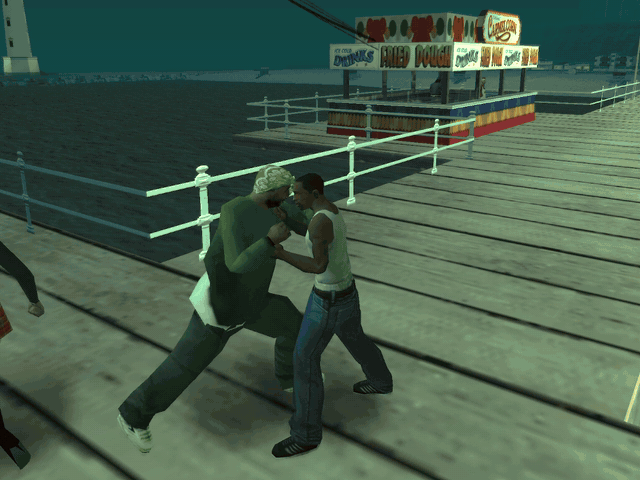

# SA Delirium

<p align="center">
  
</p>

Delirium lleva físicas, combate y conducción inspirados en GTA IV a GTA San
Andreas clásico de PC. Puedes instalar el núcleo en tu juego o preparar un
perfil completo con los extras.

## Instalar

Descarga [SA-Delirium-0.4.0-Setup.exe](https://github.com/AdriiSuizo/sa-delirium/releases/latest)
o extrae el RAR de la misma versión. Elige la carpeta o el ejecutable de San
Andreas y selecciona tu ISO de GTA IV para Xbox 360.

- **Instalación completa** prepara un perfil con Delirium, los arreglos y los
  extras que se describen abajo. Admite Steam clásico y copias verificadas de
  PC 1.0 US. La descarga de Urbanize se hace desde su autor.
- **Solo Delirium** instala el núcleo en una carpeta de PC 1.0 US con un
  ejecutable admitido. Conserva los archivos existentes. Reutiliza un cargador
  ASI verificado o añade uno compatible si hace falta.

Necesitas Windows10/11 x64 con .NET Framework4.8, tu **GTA San Andreas clásico**
y una **ISO compatible propia de GTA IV para Xbox360**. Sirve la copia de Steam
(AppID12120) o una de PC 1.0 US, incluida una copia de Steam ya degradada. Lo que
cuenta es el juego: cada archivo se comprueba por su huella frente a su versión de
Steam o de PC 1.0. Con una copia 1.0 se conserva su radio completa; con Steam
queda la radio que Steam distribuye, sin las canciones que Rockstar retiró. Al elegir la
carpeta, el asistente dice qué edición ha encontrado y por qué sirve o no: Steam,
alemana, PC 1.0, otras versiones de disco, Definitive Edition o un ejecutable
desconocido, cuyo código SHA-256 muestra para poder añadirlo. Si algún archivo está
modificado o falta, se detiene sin tocar nada y dice cuál.

Para GTA IV, el asistente comprueba el ejecutable dentro de la ISO antes de
copiar San Andreas. Admite las compilaciones verificadas de Xbox 360
Europa/Asia (Media ID `4A53F9F6`) y USA (Media ID `6AC07221`). La comprobación
se basa en la huella del ejecutable dentro de la imagen.
No necesitas la carpeta de desarrollo ni otra instalación de GTA IV de PC.
Solo Urbanize requiere conexión durante la instalación; el asistente lo descarga
automáticamente de su distribución original, sin pedir otro archivo. Los recursos de GTA IV
se generan en tu equipo desde la ISO; después puedes quitarla de esa ruta.

Se requiere espacio para el perfil y su preparación temporal (aproximadamente
15GB adicionales). Las rutas de instalación deben admitir el límite nativo de
SA1.0 para los nombres de sus partidas; el asistente comprueba ese límite.
Si faltan DirectX9 D3DX/XInput, el asistente ofrece el redistribuible original de
Microsoft incluido; su instalador puede pedir permisos de administrador.

## Cambios en 0.4.0

En **Pausa → Opciones** puedes cambiar entre Delirium GTA IV y Clásico retocado
en partida. La instalación completa también ofrece Izzy 1.6, que se aplica
al reiniciar. La deformación y el movimiento de CJ tienen sus propios ajustes.
Desde un vehículo, **L1** apunta y **R1** dispara. Mantén **L3 + R3** para
alternar la gravedad reducida.

Consulta el [historial](CHANGELOG.md) para ver los cambios de combate, cobertura,
físicas y conducción.

## Contenido de la instalación completa

Incluye Delirium y la integración de físicas/combate/movimientos, Izzy Lively
Vehicle Physics1.6 con sus ajustes originales de puertas, SkyGfx Extended1.7,
timecycle PS2, Project2DFX y FxsFuncs1.1. También CLEO/CLEO+, Mod Loader, SilentPatch, GInput, Widescreen Fix,
Windowed Mode, Open Limit Adjuster, Framerate Vigilante y PortableGTA.
DXVK se comprueba en el equipo; si no puede crear un dispositivo, se usa D3D9
de Windows. Los créditos y readmes originales se instalan en `SA/Documentation`.

Se conservan Urbanize, Grinch Trainer, Advanced Aiming y los eventos civiles de desarrollo.
La configuración de combate, físicas y movimientos de Delirium se conserva.

El asistente te deja elegir los modelos de personajes: los originales del juego, con codos
y rodillas suavizados en tu PC a partir de tu propia copia, o
**HD Skin Pack 299 de V@DO$**, que se descarga de su enlace original en GTAInside y
nunca va dentro del instalador.

Quedan fuera los mods visuales sin permiso de redistribución registrado (BSOR/LOD Vegetation, NextGen Grass, NextGen Remaster Effects, Enhance
ParticleTXD, SA Brightened, Jefferson Retextured, Parallax Interiors, neones/lámparas
y Rubbish GTA4). Puedes añadirlos tú desde sus autores con Mod Loader.

También quedan fuera **ambos packs de armas añadidos** (GTA V Weapons y NeXtGen Remaster
Weapons), RoSA/Proper Player Retex, GTA IV Textures and HQ Roads y el
HUD/minimapa/rueda de GTA V. Las armas usan los recursos de San Andreas de Steam.
Esta selección corresponde a la aclaración del usuario: «Todo menos las armas»,
conservando sus exclusiones anteriores. La entrega0.3.0 era un perfil más reducido.

Urbanize se mantiene separado según su licencia, que prohíbe reempaquetarlo en
modpacks desde octubre2026. El asistente obtiene su original y aplica los ajustes
locales verificados. Se instalan sus readmes/licencia y se acredita a
[Junior_Djjr](https://www.mixmods.com.br/2026/02/urbanize/).

## Compatibilidad de instalaciones existentes (corrección candidata)

El instalador acepta archivos de audio en `audio/sfx/` y `audio/streams/`,
y `stream.ini`, de diferentes ediciones del juego cuando la receta **solo
los copia**: registra y comprueba su hash real durante la preparación. Un
archivo ausente o vacío sigue bloqueando la instalación. Los ejecutables,
DLL del paquete, scripts, modelos y recursos que necesitan un parche binario
siguen utilizando las comprobaciones estrictas.

**Solo Delirium** conserva los posibles cargadores ASI que ya existen en
`vorbisFile.dll`, `winmm.dll` o `dinput8.dll` cuando no coinciden con
las huellas conocidas. Se avisa de que un cargador desconocido **no está
validado**: instalar el mod no garantiza que ese cargador lo ejecute.
No se sobrescribe ni se añade otro cargador encima. Si faltan las bibliotecas
que necesita el juego o el archivo está vacío, se sigue notificando el error.
Para una instalación reproducible, utiliza una copia limpia verificada.

El comando `--verify-source` añade al informe
`copied_without_catalogued_hash`, separado de `missing_or_changed`.
Esto ayuda a distinguir una edición distinta de un archivo que realmente
falta. Son cambios en el **código fuente**, no en el instalador publicado:
hasta compilar y probar un nuevo ejecutable no afectan a la versión 0.4.0
descargable.

**Si el juego se cierra al iniciar una partida:** comprueba si ocurre también
con una partida nueva y sin otros mods, guarda los registros de
`logs/manual-sessions` junto al perfil `SA` cuando existan y consulta
el módulo con errores en el Visor de eventos de Windows → Registros de Windows
→ Aplicación. Indica tu edición de GTA SA, modo de instalación, GPU y
el nombre del módulo; un cierre después de instalar no permite identificar
el plugin responsable por sí solo. No borres las partidas de `SA/userfiles`.

## Ejecutable original del disco de PC 1.0 US

El instalador puede identificar el ejecutable original de disco de
14.405.632 bytes con SHA-256
`8c609f108ad737deffbd0d17c702f5974d290c4379de742277b809f80350da1c`.
**Identificarlo no significa que sea compatible.** El ejecutable es distinto
del 1.0 US verificado que usa el runtime y no se aplica ninguna transformación
sin una receta binaria y comprobaciones de salida válidas.

Para incorporar esa edición hará falta analizar una copia legítima del ejecutable
original y producir un parche diferencial hacia el perfil existente. El proceso
de construcción ya admite ejecutables auditados mediante
`--classic-executable`, pero **el hash anterior no figura entre las fuentes
aprobadas para generar deltas**. No se incluyen ejecutables originales ni se
sustituyen archivos del usuario a ciegas. Hasta que exista una receta verificada,
se debe utilizar una edición ya compatible y se conservará intacta la instalación
original.

## Partidas, restauración y diagnóstico

En **Solo Delirium**, abre tu juego como siempre. **Restaurar** retira los
archivos registrados por el asistente y conserva las partidas de la instalación.

Con Steam, el mod crea su perfil independiente en **SA** dentro de la carpeta de
Steam. Se adapta la versión interna del juego para los plugins y se respalda el
`gta-sa.exe` original. Un lanzador espera a que termine el juego para mantener
su sesión en Steam. Con otra copia, el perfil se crea en la carpeta del mod que elijas, por
defecto `%LOCALAPPDATA%/SA-Delirium/Juego/SA`, con accesos directos en el escritorio y en
el menú Inicio; la carpeta de tu juego solo se lee. La carpeta de desarrollo y las partidas de Documentos se
conservan. El instalador no incluye ni importa partidas del autor.

Para desinstalar, abre el mismo asistente y pulsa **Restaurar**. Con Steam recupera
el ejecutable anterior; con otra copia quita los accesos directos. En ambos casos conserva el perfil y sus partidas en el respaldo
`SA-Delirium-backups`. Si existe una instalación anterior, restáurala primero;
no se actualizan perfiles encima de otros. Conserva siempre tus respaldos.
Verificar archivos desde Steam puede reemplazar el lanzador: restaura primero
con el asistente y después reinstala sobre los archivos verificados.

Las partidas del mod están en `SA/userfiles`. Los registros están en
`logs/manual-sessions` junto a `SA`, y en la caché local
`%LOCALAPPDATA%/SA-Delirium/Setup`. Tras una instalación terminada y con el
asistente cerrado, sus carpetas `prepared-*` y `helpers-*` son temporales y se
pueden quitar; conserva los registros si necesitas investigar un error.
No mezcles este perfil con otros loaders/renderizadores o SA-MP.

## Validación y límites

En el asistente se puede elegir el ejecutable directamente o pegar la
ruta de la carpeta. Antes de preparar el perfil, el asistente verifica los
archivos originales que necesita. Admite nombres alternativos y la variante
LAA de un ejecutable cuando puede reconstruir exactamente una entrada ya
verificada. También recupera `vorbisHooked.dll` o `vorbisFileHooked.dll` si
contienen la DLL original verificada.

Para comprobar una carpeta de referencia, basta con sus archivos. Este modo
devuelve la edición, cuántos archivos coinciden y cuáles hay que revisar.

```powershell
Start-Process -Wait .\SA-Delirium-0.4.0-Setup.exe -ArgumentList '--verify-source --target "D:\Juegos\GTA San Andreas" --report "D:\compatibilidad.json"'
```

Las huellas y las recetas verifican Steam clásico y PC 1.0 US. Otras
compilaciones con cambios en el código nativo, como 1.01, 2.0 y Rockstar Games
Launcher, requieren sus propias referencias. El asistente excluye Definitive
Edition. [Versiones de San Andreas en Plugin-SDK](https://github.com/DK22Pac/plugin-sdk/blob/master/shared/GameVersion.h).

Las pruebas históricas de la instalación con Steam se documentan en
[VALIDATION.md](installer/portable/VALIDATION-0.3.8.md). La entrega 0.4.0 se
comprobó también en una copia clásica de PC con instalación completa y
Solo Delirium.

Las pruebas son acotadas. No certifican todos los vehículos, misiones, mandos,
GPUs, idiomas o ediciones de ISO; tampoco equivalencia completa con GTA IV ni
120FPS sostenidos. Persisten límites de naturalidad, contactos de carrocería,
combate armado y ciertas combinaciones de actores/terreno.

## Fuentes y créditos

[Compilación del perfil portátil](installer/portable/BUILD.md),
[créditos de los autores](CREDITS.md), [licenciaGPLv3](LICENSE.md).
Las fuentes correspondientes acompañan la entrega. Los archivos originales
completos de los juegos, la ISO, recursos generados y partidas no se distribuyen.
Desarrollo asistido por OpenAI Codex (familiaGPT-6).

La entrega histórica `v0.2.0-dev-import.1` necesitaba una copia de desarrollo y
no sirve como instalador para otro PC. El port experimental R2 queda conservado
en [su documentación histórica](docs/NATIVE-R2-HISTORY.md).
