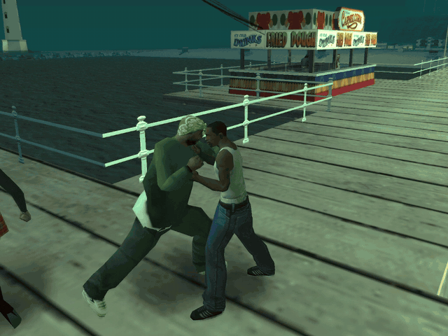

# SA Delirium 0.6.6 · SPAS-12, contraataques y cobertura

- **SPAS-12.** Cada retroceso vuelve a corresponder a un disparo. La escopeta respeta la cadencia de San Andreas según la habilidad de CJ y conserva los perdigones de Delirium.
- **Contraataques.** Los efectos de impacto siguen las marcas de cada animación de GTA IV. Cada golpe de la secuencia tiene su propio sonido.
- **Cobertura de los NPC.** Si un atacante armado ya tiene a CJ a tiro, solo se desvía hacia una cobertura que quede a dos metros o menos. Cuando pierde la línea de tiro conserva la búsqueda más amplia.
- **Conducción.** Se redujo la asistencia de agarre en las correcciones suaves de volante y se respetan los ajustes de derrape del coche equivalente de GTA IV. Se mantiene la asistencia antivuelco en taludes.

En partida, la SPAS-12 a habilidad máxima disparó 14 cartuchos en 14 retrocesos. Se registró un sonido por cada uno de los 16 impactos de contraataque probados. El pandillero disparó desde su posición con la caja lejos y completó el ciclo de cobertura con la caja cerca. El Admiral, el Comet y el Huntley completaron las pruebas en el talud del canal sin volcar.

**Instalación.** Descarga el EXE o el RAR, que contiene el mismo instalador. Necesitas GTA San Andreas clásico compatible y tu propia ISO admitida de GTA IV para Xbox 360. Elige **Completo** o **Solo Delirium**. Si actualizas una instalación gestionada por el asistente, usa primero **Restaurar** en el asistente de tu versión anterior.
